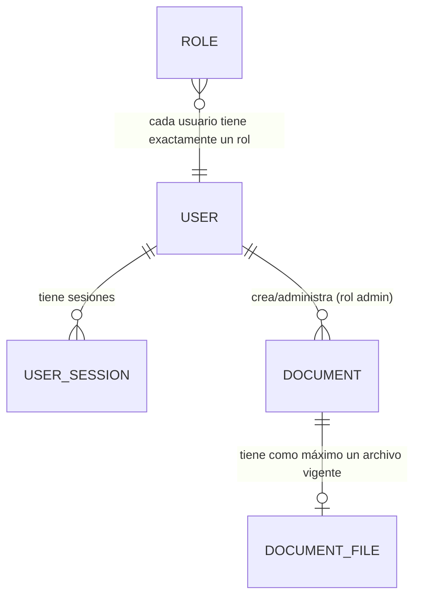

# Modelo de dominio

Modelo conceptual del Gestor de documentación oficial láctea: conceptos de negocio y sus relaciones. Se entiende sin leer código; el esquema físico está en `data-model.md` y el detalle de atributos en `entities.md`.

## Conceptos

| Concepto | Descripción |
| --- | --- |
| **Documento oficial** | Registro de una documentación o requisito impuesto por el organismo regulatorio. Objeto central del sistema. |
| **Archivo de documento** | Binario vigente (PDF, DOCX, etc.) asociado a un documento. Relación 1 a 0..1 en v1: un documento tiene como máximo un archivo; reemplazar sobrescribe. |
| **Cuerpo emisor** | Atributo de texto libre del documento que indica quién lo emitió. Sin catálogos predefinidos. |
| **Catálogo compartido** | Conjunto de los documentos no retirados, único para toda la organización (sin multi-tenant). |
| **Documento retirado (borrado suave)** | Estado de un documento cuyo `deleted_at` está marcado: fuera del catálogo, presente en la base de datos, visible solo para el administrador, restaurable. |
| **Usuario** | Cuenta con un rol exacto: administrador o normal. |
| **Rol** | Enumeración de dos valores: `admin` y `user`. |
| **Sesión de usuario** | Registro de un inicio de sesión vigente: hash del token opaco, usuario y expiración. |
| **Papelera de reciclaje** | Vista administrativa sobre los documentos retirados. |

## Relaciones

| Relación | Cardinalidad | Notas |
| --- | --- | --- |
| Usuario → Sesiones | 1 a N | Un usuario puede tener varias sesiones vigentes; cada sesión pertenece a un solo usuario. |
| Usuario → Documentos | 1 a N (solo rol admin) | El administrador crea y modifica documentos; el modelo no asocia documentos a empresas ni a usuarios concretos: el catálogo es compartido. |
| Documento → Archivo | 1 a 0..1 | Clave foránea única (`document_files.document_id` UNIQUE); un documento puede existir sin archivo todavía. |
| Documento → Estado retirado | propio | No es una entidad aparte: el marcador `deleted_at` en el propio documento define la visibilidad y la papelera. |

## Invariantes de dominio

1. **Catálogo único**: no existen conceptos de empresa, tenant u organización en el modelo; todos los usuarios autenticados ven los mismos documentos no retirados.
2. **Dos roles, nada más**: no hay permisos granulares ni jerarquías; toda autorización deriva del rol y del estado de la cuenta.
3. **Retirar ≠ destruir**: el borrado suave es la única forma de quitar un documento del catálogo en v1; el registro y su archivo permanecen para la papelera y la restauración.
4. **Archivo único vigente**: no hay historial de versiones de archivo ni de metadatos en v1; el reemplazo actualiza en el lugar.
5. **Sin cumplimiento**: el modelo no representa obligaciones, vencimientos ni verificaciones regulatorias; solo documentos y su archivo.
6. **Sin jurisdicción codificada**: no hay entidades de país, regulador ni tipo de documento como catálogo; son textos libres.

## Conceptos deliberadamente ausentes

| Concepto | Motivo |
| --- | --- |
| Empresa / tenant | Resuelto: una sola organización, catálogo compartido (`CONFIRMADO`). |
| Versión de documento | Nunca definido en el brief; v1 no define semántica de versionado (decisión de diseño para v1). |
| Obligación de cumplimiento / vencimiento | Fuera de alcance explícito. |
| Auditoría (quién cambió qué) | Pregunta P2 sin respuesta; fuera del primer slice. |
| Notificación | Fuera de alcance explícito. |
