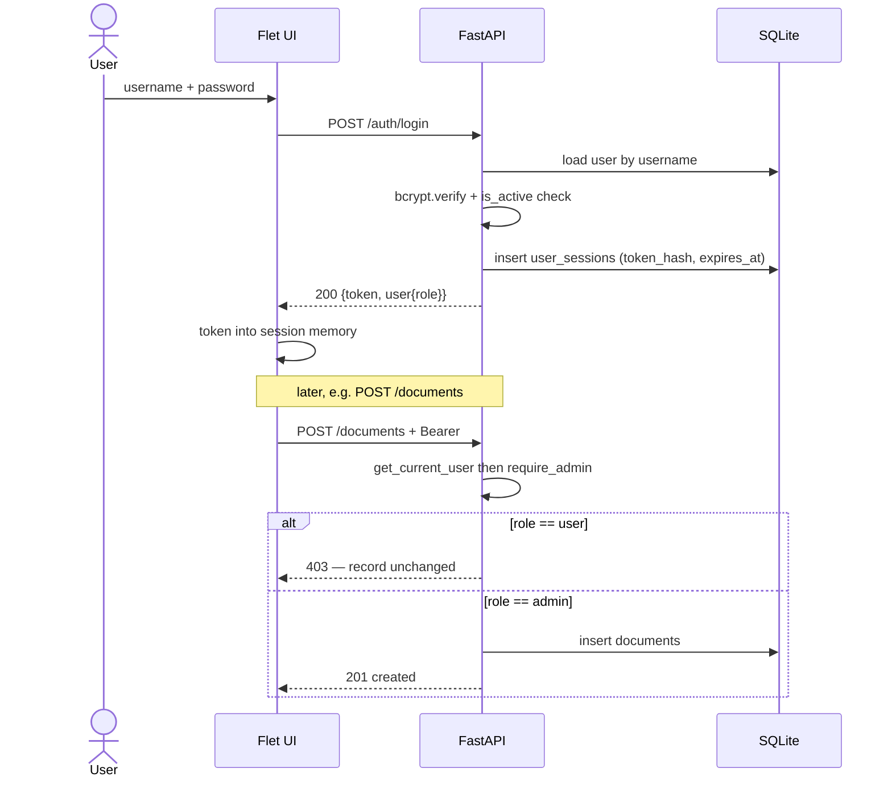

# Design: dairy-doc-manager

## Technical Approach

Greenfield (no application code exists) — this design establishes the project's conventions. One Python codebase, one REST API process (FastAPI + SQLModel + SQLite WAL, PEP 604 `X | None`, Python >= 3.10). The Flet UI always talks to the backend through the HTTP API, never in-process: web co-locates the UI via `flet.fastapi`; desktop/mobile run the same UI natively over HTTP. Single uvicorn worker (SQLite single-writer).

## Architecture Decisions

### Decision: Per-Target Deployment Shape (central)

| | Web | Desktop | Mobile |
|---|---|---|---|
| Flet UI process | mounted in FastAPI: `app.mount("/flet-app", flet_fastapi.app(main))` incl. `/ws`, `/upload` | native `flet run` / packaged exe; embedded Flet server | `flet build` apk/ipa; same Python code on device |
| API access | loopback HTTP, same process | HTTP(S) to `DOCMANAGER_API_URL` | HTTPS to `DOCMANAGER_API_URL` |
| Auth state | bearer token held in Flet session memory; server-side truth in `user_sessions` (no cookie jar) | same | same |
| Deployables | 1 process | Flet app + reachable API | Flet app + reachable API |

**Choice**: one REST API process is the system of record on every target; web co-locates the UI in it; desktop/mobile are thin native clients.
**Alternatives considered**: separate Flet server + API everywhere (2 deployables on web — worse ops); Flet-only with local SQLite per client (no shared catalog — breaks multi-user); API-only + JS SPA (violates fixed stack).
**Rationale**: satisfies "sistema sencillo" — one deployable for web, one codebase everywhere, no gateway; reuses verified `flet.fastapi`; one HTTP authorization boundary testable identically on all targets. Cost: desktop/mobile need a reachable server + URL config; web loopback HTTP is negligible at confirmed volume. **Risk**: `flet.fastapi` is new — pin exact `flet==X.Y.Z` in `pyproject.toml`; first task is a spike proving `/ws` + file pick/upload on the pin before feature work.

### Decision: Auth — Opaque Server-Side Sessions

**Choice**: login mints a random 256-bit token; only its SHA-256 lands in `user_sessions`. Every request carries `Authorization: Bearer`. FastAPI deps `get_current_user` (token → session → user; rejects expired token, dead session, `is_active=False`) and `require_admin`. Logout deletes the session row; deactivation kills sign-in AND in-flight sessions on next request.
**Alternatives considered**: JWT (rejected — revocation needs a DB check anyway at this scale; extra crypto/config surface); cookie sessions (rejected — native desktop/mobile have no browser cookie jar).
**Rationale**: trivial revocation in SQLite; no self-service flows justify stateless tokens. `CONFIRMED` (user): bcrypt via maintained `bcrypt` lib (not passlib), 12h TTL. Both are isolated to `core/security.py`.

### Decision: One API Client Path for All Targets

**Choice**: Flet views call `app/ui/api_client.py` (httpx + bearer header) for every operation, including web's co-resident API.
**Alternatives considered**: direct service-layer calls on web (rejected — forks logic; hides the authz boundary on one target).
**Rationale**: one client code path, one enforcement point, target parity in tests.

### Decision: File Storage — Filesystem, Per-Document Directory

```
$DOCMANAGER_STORAGE_DIR/            # default ./var/storage, gitignored
  documents/{document_id}/file      # single current binary per document (v1)
```

`document_files` stores original_filename, content_type, size_bytes, sha256, stored_path. **Server generates all paths — client filenames never touch the filesystem** (traversal-safe). Upload = admin-only PUT multipart; extension + content-type allowlist (PDF, DOCX, XLSX, ODT, PNG, JPG) and size cap 25 MB — `CONFIRMED` (user). Replacement overwrites in place; no file versioning in v1. Downloads stream via GET; soft-deleted docs refuse non-admins; admin recycle bin may fetch.
**Alternatives considered**: blobs in SQLite (bloats DB, breaks streaming); S3 (deployment target unknown — overkill).
**Rationale**: simplest operable store for hundreds of files; swappable behind `file_service`.

### Decision: Soft Delete via `deleted_at`

`documents.deleted_at: datetime | None`; NULL = active. Delete sets timestamp, restore clears it; hard delete absent from API and UI. Catalog queries default to `deleted_at IS NULL`; partial index on it; admin recycle bin queries `deleted_at IS NOT NULL`.

### Decision: Multi-Admin Allowed

Two-role model admits N admin accounts; account UI can create admins. `CONFIRMED` (user): multi-admin allowed. If exactly-one-admin is required later, add a guard/partial unique index — additive change.

### Decision: First-Admin Bootstrap via CLI Command

**Choice**: the first administrator is created by an explicit terminal command, in the manner of Django's `createsuperuser`:

```
python -m app.cli create-admin        # prompts for username and password, getpass, no echo
python -m app.cli create-admin --username <name>   # password still prompted, never argv
```

The command refuses to run when `users` already contains an admin unless `--force` is given, hashes the password with the same `core/security.py` bcrypt path used at runtime, and writes one `users` row. `app/cli.py` uses stdlib `argparse` + `getpass` — no new dependency. No self-registration routes exist; this is the only way an admin account comes into being on a fresh install.

**Alternatives considered**: `DOCMANAGER_BOOTSTRAP_ADMIN_*` env vars read at app boot (rejected — the secret then lives in the process environment of a long-running server, is visible to any operator who can inspect the process or its systemd unit, and silently re-runs on every restart); a seed fixture committed to the repo (rejected — a shared password in version control); creating the first user from the Flet UI before auth exists (rejected — the UI requires a session, which is exactly the chicken-and-egg).

**Rationale**: matches the user's explicit instruction and Django's proven pattern; the credential is typed by a human on an operator terminal and never persisted outside the hashed `users` row; works identically on web, desktop, and mobile deployments because it touches only the database, not the HTTP surface. Cost: one extra operational step after `create_all` on a fresh install. Mitigation: the app must not look broken when zero admins exist — the API returns 401 and the UI shows the Spanish message directing the operator to run the command.

## Data Flow

    Flet UI (web | desktop | mobile)
         │  httpx + Bearer
         ▼
    FastAPI /api/v1  ── deps: get_current_user / require_admin
         ├── services ── SQLModel ── SQLite (WAL)         … metadata
         └── file_service ── var/storage/documents/{id}/file  … binaries

Bootstrap (chicken-and-egg): no admin is created automatically. After `create_all` on a fresh install the operator runs `python -m app.cli create-admin` to create the first administrator. No self-registration routes exist.

## Data Model (SQLModel)

```python
class Role(str, Enum):
    admin = "admin"
    user = "user"

class User(SQLModel, table=True):
    __tablename__ = "users"
    id: int = Field(primary_key=True)
    username: str = Field(unique=True, index=True)
    password_hash: str
    role: Role
    is_active: bool = Field(default=True, index=True)
    created_at: datetime
    updated_at: datetime

class UserSession(SQLModel, table=True):
    __tablename__ = "user_sessions"
    id: int = Field(primary_key=True)
    token_hash: str = Field(unique=True, index=True)
    user_id: int = Field(foreign_key="users.id", index=True)
    created_at: datetime
    expires_at: datetime = Field(index=True)

class Document(SQLModel, table=True):
    __tablename__ = "documents"
    id: int = Field(primary_key=True)
    title: str = Field(index=True)                 # CONFIRMED (user)
    issuing_body: str = Field(index=True)          # CONFIRMED, free text
    description: str | None = None                 # CONFIRMED (user)
    document_type: str | None = None               # CONFIRMED (user); free text — enum catalogs forbidden
    issued_on: date | None = None                  # CONFIRMED (user)
    deleted_at: datetime | None = Field(default=None, index=True)
    created_at: datetime
    updated_at: datetime

class DocumentFile(SQLModel, table=True):
    __tablename__ = "document_files"
    id: int = Field(primary_key=True)
    document_id: int = Field(foreign_key="documents.id", unique=True, index=True)
    original_filename: str
    content_type: str
    size_bytes: int
    sha256: str = Field(index=True)
    stored_path: str
    uploaded_at: datetime
```

Extra index: partial `(deleted_at) WHERE deleted_at IS NULL`. Search = SQL `LIKE` over indexed metadata columns; recorded performance review decides; FTS5-over-metadata is the documented upgrade path if the (TBD) latency target fails. `CONFIRMED` (user): the four document fields above and the search/filter dimensions (free-text `query` over indexed metadata; filter by `document_type`, `issuing_body`, and the admin-only `deleted` flag).

## API Surface (`/api/v1`)

| Method & path | Auth | Purpose |
|---|---|---|
| POST /auth/login · POST /auth/logout · GET /auth/me | public · any · any | session lifecycle |
| GET/POST /users · PATCH /users/{id} | admin | create, edit, role, is_active toggle, admin-set password |
| GET /documents (query, filters, `deleted` for admin) | any | list/search/filter |
| POST /documents · PATCH /documents/{id} | admin | CRUD |
| DELETE /documents/{id} · POST /documents/{id}/restore | admin | soft delete / restore |
| GET /documents/{id}/file | any (404 if deleted & non-admin) | download |
| PUT /documents/{id}/file | admin | upload/replace multipart |

Errors: 401 unauthenticated, 403 wrong role, 404 hidden/absent, 413 oversize, 415 disallowed type.

## Component Breakdown

| Path | Role |
|---|---|
| `pyproject.toml` | pinned deps: fastapi, uvicorn, sqlmodel, flet (+`flet.fastapi`), httpx, bcrypt; pytest, ruff |
| `app/main.py` | app factory; routers; `flet.fastapi` mount; `create_all` |
| `app/cli.py` | stdlib `argparse` + `getpass`; `create-admin` — first-admin bootstrap |
| `app/core/{config,security}.py` | env settings; hash/verify; token mint/verify |
| `app/db/{session,models}.py` | engine (WAL, `foreign_keys=ON`); table models |
| `app/services/{auth,user,document,file}_service.py` | domain rules incl. authorization-adjacent checks |
| `app/api/deps.py`, `app/api/routes/{auth,users,documents,files}.py` | HTTP surface; `get_current_user`, `require_admin` |
| `app/ui/**` | Flet views + `api_client.py`; Spanish (neutral) copy lives here only |
| `tests/` | unit (services/security), integration (API + temp SQLite + temp storage), api_client contract |
| `var/storage/` | runtime binaries, gitignored |

Entry points: `uvicorn app.main:app` (web+API) · `python -m app.cli create-admin` (first-admin bootstrap) · `flet run app/ui` (desktop, `DOCMANAGER_API_URL` set) · `flet build` same UI entry (mobile).

## Sequence Diagrams

### Sign-in + role enforcement



### Upload (admin)

```mermaid
sequenceDiagram
  actor A as Administrator
  participant UI as Flet UI (FilePicker)
  participant API as FastAPI
  participant FS as var/storage
  participant DB as SQLite
  A->>UI: pick file
  Note over UI: web: flet.fastapi /upload feeds session temp;<br/>desktop/mobile: local path
  UI->>API: PUT /documents/{id}/file (multipart, Bearer)
  API->>API: require_admin; allowlist ext+content-type; size cap
  API->>DB: load document (must exist; deleted only for admin replace)
  API->>FS: write documents/{id}/file (server-generated path)
  API->>DB: upsert document_files (sha256, size, original_filename)
  API-->>UI: 200 file metadata
```

### Download with authorization

```mermaid
sequenceDiagram
  actor U as User or Admin
  participant UI as Flet UI
  participant API as FastAPI
  participant DB as SQLite
  participant FS as var/storage
  U->>UI: Descargar
  UI->>API: GET /documents/{id}/file + Bearer
  API->>API: get_current_user
  API->>DB: load document + document_files
  alt deleted_at not null and role == user
    API-->>UI: 404 (no existence leak)
  else active, or admin on deleted
    API->>FS: read documents/{id}/file
    API-->>UI: 200 bytes + Content-Disposition
    UI->>UI: web: browser download; desktop/mobile: save dialog
    UI-->>U: file saved
  end
```

### Soft delete + restore

```mermaid
sequenceDiagram
  actor A as Administrator
  participant UI as Admin recycle-bin view
  participant API as FastAPI
  participant DB as SQLite
  A->>UI: Quitar documento obsoleto
  UI->>API: DELETE /documents/{id} + Bearer
  API->>API: require_admin
  API->>DB: update documents set deleted_at = now
  API-->>UI: 204
  Note over DB: record + file retained; user queries filter deleted_at IS NULL
  A->>UI: Restaurar
  UI->>API: POST /documents/{id}/restore
  API->>DB: update documents set deleted_at = NULL
  API-->>UI: 200 — reaparece en el catálogo
```

## Interfaces / Contracts

```python
# app/api/deps.py — PEP 604 signatures
def get_current_user(token: str = Depends(bearer_scheme), db: Session = Depends(get_db)) -> User
def require_admin(user: User = Depends(get_current_user)) -> User

# app/ui/api_client.py — one client for all targets
class ApiClient:
    def __init__(self, base_url: str, token: str | None = None) -> None
    def login(self, username: str, password: str) -> UserOut
    def list_documents(self, *, query: str | None = None,
                       document_type: str | None = None,
                       issuing_body: str | None = None,
                       deleted: bool | None = None) -> list[DocumentOut]
    def upload_file(self, document_id: int, local_path: str) -> FileOut
    def download_file(self, document_id: int) -> bytes

# app/cli.py — first-admin bootstrap (Django `createsuperuser` pattern)
def create_admin(*, username: str, password: str, force: bool = False) -> User
# main(): argparse; getpass prompts for the password (never on argv, never echoed);
# exits non-zero with a Spanish operator message when an admin exists and force is False.
```

## Testing Strategy

| Layer | What | Approach |
|---|---|---|
| Unit | hash/token logic; soft-delete, role gates, allowlist rules | pytest + temp SQLite |
| Integration | anon 401; user 403 on every admin route; login/deactivate/reactivate; upload size/type rejects; download authz incl. deleted-doc 404 | FastAPI TestClient + tmp storage |
| CLI | `create-admin` on empty DB creates a bcrypt-hashed admin; refuses to run when an admin exists unless `--force`; password never appears on argv or in logs | pytest + temp SQLite, `getpass` patched |
| UI client | `api_client` contract with mocked httpx | pytest |
| E2E / manual | three-target smoke (web mount, desktop run, mobile build); search-performance review at seeded volume (>=300 docs, 100 users), timings recorded | spike + verify-report note |

## Threat Matrix

N/A for process automation — no subprocesses, VCS/PR automation, executable-file classification, or process-integration boundaries. HTTP surface covered under Interfaces/Contracts; upload hardening (allowlist, size cap, server-generated paths, stored files never executed) designed under file storage. CLI-specific exposure: `create-admin` must read the password via `getpass` (no echo) and MUST NOT accept it as an argv flag, so it never lands in shell history, `ps` output, or process listings.

## Migration / Rollout

Greenfield — no data migration. `create_all` on first boot; the operator then runs `python -m app.cli create-admin` to create the first administrator (no admin is created automatically). Post-release evolution: additive SQLite ALTERs until a breaking change justifies Alembic. Natural PR slices for sdd-tasks (total >> 400-line budget; delivery_strategy `ask-on-risk`): (1) scaffold/config/db/security + `app/cli.py` `create-admin`, (2) auth+users API, (3) documents CRUD + soft delete + search, (4) file storage upload/download, (5) shared Flet views + api_client, (6) admin views (documents, recycle bin, users), (7) `flet.fastapi` web mount + packaging, (8) performance review.

## Open Questions

- [ ] Deployment target and operator — the only remaining P0; decides HTTPS, hosting, mobile URL distribution.
- [ ] Search latency target — threshold that the phase-8 performance review must meet or escalate; without it the review has no pass/fail.
- [ ] Exact Flet symbols for web download and FilePicker temp handling — verified in the pinned-version spike (this design assumes behavior, not symbol names).

## Confirmation Record

On user review the following design assumptions were confirmed and are no longer open: the four document fields (`title`, `description`, `document_type`, `issued_on`); the search/filter dimensions; the upload allowlist (PDF, DOCX, XLSX, ODT, PNG, JPG) and the 25 MB size cap; server-side opaque sessions with bcrypt via the `bcrypt` library and a 12 h TTL; multi-admin accounts allowed. Deployment target/operator and the search latency target remain open.
